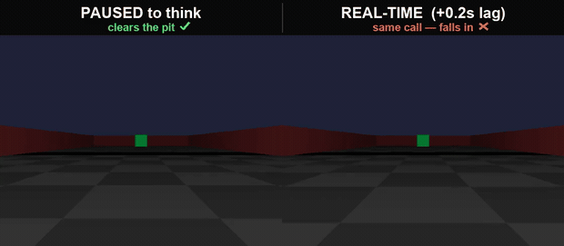

# Judge vs. React

**Dissociating perception from timing in VLM reflex control.**

A vision-language model playing a real-time game can fail two ways that
benchmark scores conflate: it can misjudge the scene (perception), or judge
correctly and act too late (timing). This repo is a minimal, deterministic
first-person apparatus that pulls the two apart — plus the data, analysis, and
preprint built on it.



Same agent, both panels. Left: the world pauses while it thinks — it clears
every time. Right: real time, the decision lands late — it walks into the pit.
The judgment never changed; only the clock did.

## Results

- **A real model through the boundary (headline):** a closed-loop Sonnet 4.6
  agent, judging every frame itself and swept through the transition by
  injected delay, clears 32/32 in-window decisions below `r ≈ 1` and 0/26
  above it (`r* = 1.05`), with nothing varied but the delay. Past the boundary
  its only clears are *delay-rescued misjudgments* (early jumps pushed into
  the window by the delay): the two failure axes compensate.
- **A per-frame judge is a first-passage process:** a 1% per-frame false
  JUMP rate fires somewhere in the ~90-frame approach 60% of the time (84% at
  2%); the two-consecutive-JUMP commit rule cuts that to ~1% / 3%. Per-frame
  accuracy batteries cannot see this; evaluate per episode.
- **The commit point is nearly deterministic:** 63 of 72 in-window decisions
  land within one tick of each other across six seeds, so the real judge's
  transition is a step, not a curve.
- **Fog in closed loop:** the same judge swept through the boundary under
  fog commits over a five-tick spread, 35/72 episodes early (vs 9/72 clear);
  the in-window boundary does not move (`r* = 1.01` vs 1.05), 22 of the early
  commits are rescued by delay, and both sweeps clear exactly 41/72 with
  opposite composition (36+5 vs 19+22). An aggregate score cannot tell them
  apart.
- **A second judge:** Haiku 4.5 through the same grid commits two ticks
  later than Sonnet and its cliff moves by exactly two ticks (`r* = 0.96` vs
  1.05, 24/24 then 0/31); its early commits are far-field first-passage
  errors no delay can rescue; 26/72, as the sweep equation predicts from its
  commit distribution.
- **The same judge on a second scene:** Sonnet 4.6 on a rendered aiming
  task commits inside the window in 72/72 episodes, but one to five ticks
  into a 12-tick window (mode 4.9 ticks, `δ = 0.41`), so its cliff sits at
  `r* = 0.65` instead of 1.05: 30/30 through `r = 0.51`, 5/6 and 2/6 at the
  next two delays, 0/30 from `r = 0.77`. Every episode obeys the same rule
  as the pit's (hit iff commit tick + delay ≤ 55). The cliff is set by where
  the judge commits, not by how well it sees. The deliberation stall is here
  too: median 11.7 s per call on the five frames around the window's near
  edge against 3.7 s far from it.
- **The offline battery predicts the sweep:** from a three-sample frame
  battery and the commit rule alone, the modal commit comes out exact for
  both judges on the clear pit and within two ticks elsewhere, and the
  72-episode total within 1 to 4 (42.0/41, 44.7/41, 30.0/26, 36.7/37
  predicted/observed). It misses the rare early commits (0 predicted vs 9
  and 11). `eval/pit/realmodel/predict_from_battery.py`.
- **The judge's own latency through the boundary:** with no injected delay
  and the sim's clock rate swept instead, so that each decision's real
  latency is its own delay, the same judge clears 0/30 until `r < 1/3` (two
  consecutive JUMPs must fit the window), 18/18 once the clock is slow
  enough, and in between 10 of 11 failures are a deliberation stall: 10–32 s
  calls on the frame just before the window, against 2.6 s everywhere else.
  The real-time budget is the longest latency on the approach, not the median.
  At low effort the stall is gone and the same frames are misjudged instead
  (54% false JUMP), so the judge commits early in 58/72 episodes and clears
  8/72: effort trades the stall for a first-passage failure on the same frames.
- **Perception axis (API battery, n=100 per cell):** with a neutral prompt no
  hosted model judges the depth cue (all at chance; Sonnet and Opus just say
  WAIT). With a prompt that names the cue, every model is near ceiling in
  clear weather (Haiku 97%, Sonnet 91%, Opus 99%), and fog then costs the
  smallest model most (Haiku to 68%). A local Qwen2.5-VL 7B gives a constant
  answer in both arms (WAIT, then JUMP) and stays at chance. Perception of
  this scene is a property of the prompt. An earlier subagent-judged n=10 pilot that claimed unprompted
  depth reading is retracted.
- **Latency axis:** the window is open ~257 ms; hosted frontier VLMs decide in
  ~1–1.5 s (`r ≈ 4–6`), local open VLMs in 8–12 s (`r ≈ 31–47`). All past the
  boundary. Pausable/turn-based deployment converts the same models from
  failing to viable.
- **Calibration, not a law:** `r = v·D / W` is the coordinate in which "a
  leading-edge policy clears iff `r < 1`" is exact by construction. Oracle
  sweeps on the pit (`r* = 1.04` on a 1-tick delay grid; every width brackets
  the edge within one tick) and on a rotational aiming task
  (`r* = 0.98`) confirm the apparatus reproduces it.
- **Control:** action-repeat adds polling delay and shifts the transition to
  lower explicit `r`; it is a cost lever, not a latency fix.

The preprint is [`paper/judge-vs-react.pdf`](paper/judge-vs-react.pdf); an
accessible writeup is [`paper/blog.md`](paper/blog.md).

## Reproduce

The sim is self-contained C (SDL2 + libm; `brew install sdl2` or
`apt install libsdl2-dev`); analysis is Python via
[uv](https://docs.astral.sh/uv/).

```bash
# build the deterministic sim
cmake -B raycaster/build -S raycaster && cmake --build raycaster/build

# regenerate the figures + fits from the committed data
KEEN_BIN=raycaster/build/keen-raycaster \
  uv run --with matplotlib --with numpy --with scipy python -m eval.pit.analyze
# ...and the real-model figures (fig_realmodel*, fig_clock, fig_firstpassage, fig_aim_real)
for f in fig_realmodel fig_clock fig_firstpassage fig_aim_real; do
  uv run --with matplotlib --with numpy --with scipy python eval/pit/realmodel/$f.py
done

# tests (7 shell + 51 pytest, incl. a regression suite pinning every paper number to the data)
( cd raycaster && for t in tests/*.sh; do bash "$t"; done )
KEEN_BIN=raycaster/build/keen-raycaster \
  uv run --with pillow --with pytest --with numpy --with scipy --with matplotlib \
  python -m pytest eval/pit/tests/ -q
```

The local-VLM paths (Ollama) and the blind Claude judges run without an API
key; only the hosted-API latency numbers required one. Sweeps:
`eval/pit/run_oracle_sweep.py`, `run_edge_sweep.py` (1-tick calibration grid),
`run_aim_sweep.py`, `run_vlm.py`.

## Layout

| Path | What it is |
|---|---|
| `raycaster/` | Deterministic C/SDL2 first-person sim: pit-jump episode, `--task aim` (second task), injected control delay, headless modes. `pit_agent.py` drives it as an external agent (rules / Claude vision / Ollama backends). |
| `eval/pit/` | Analysis (`analyze.py`: all figures + fits), sweep runners, committed data (`data/*.jsonl`), figures, tests. |
| `paper/` | Preprint (`.tex`/`.pdf`), working draft (`.md`), blog post, arXiv bundle + `make-arxiv.sh`. |
| `docs/prior-art-fulltext.md` | Full-text prior-art check behind the related-work section. |

## Origin

This apparatus was extracted from a larger project exploring first-person
Commander Keen-style play with vision models. The pit-jump task started as
"the hard part is judging jump depth from a flat frame" and became the
measurement instrument here.
