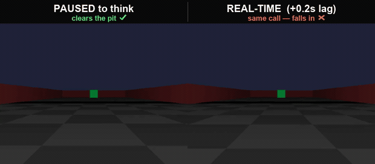
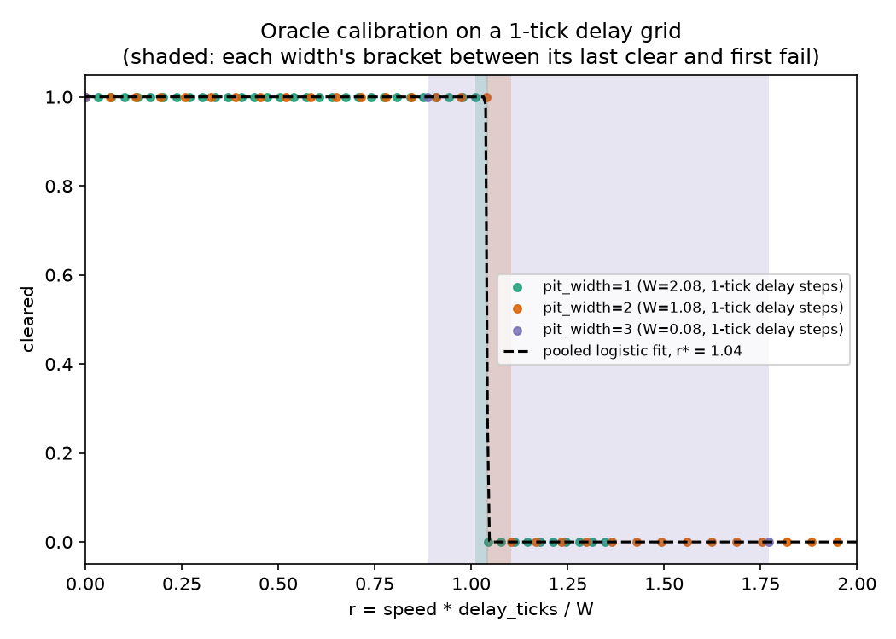
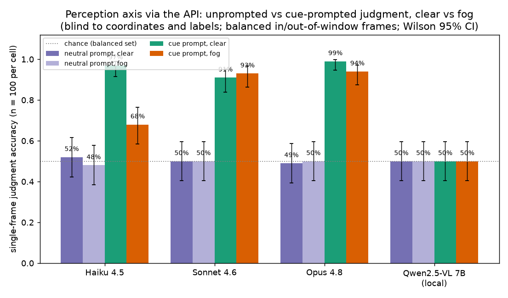
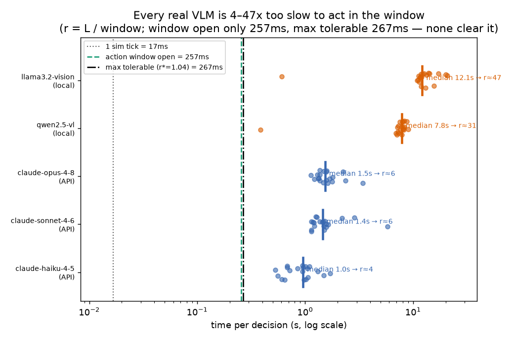
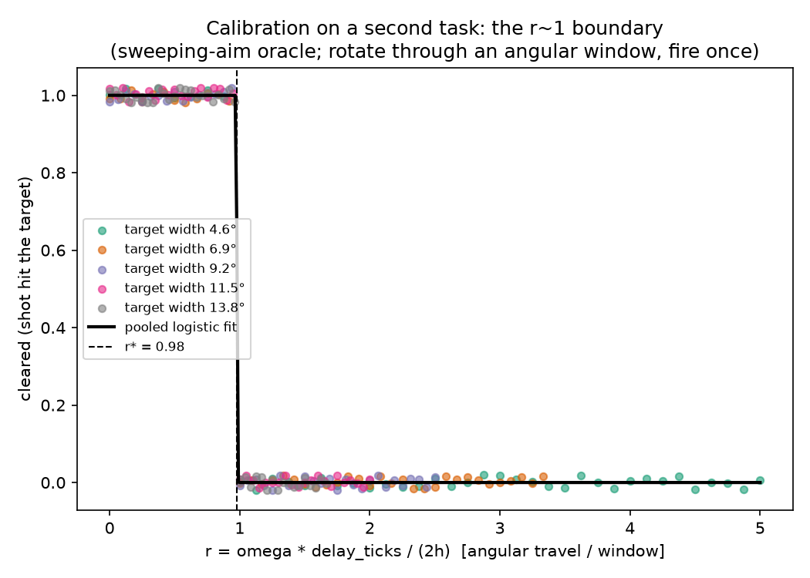
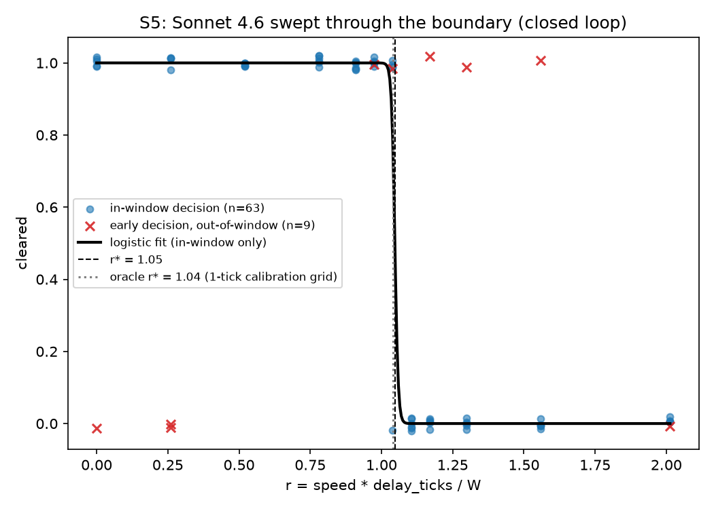
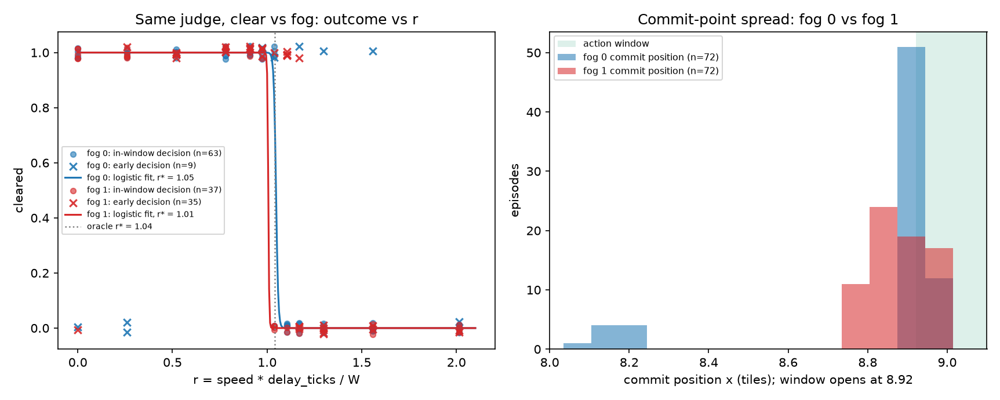

# When the AI isn't dumb, it's just late

*A first-person jumping game where the hard part is judging distance — and what it
teaches about why vision models "can't play games."*

It started as a toy: a little first-person raycaster with one pit in the floor.
You walk forward, and the only thing you ever decide is *when to jump*. In first
person there's no map, no bird's-eye view — you're guessing at depth from a flat
image, the same handicap a person gets. That made it an interesting thing to point
a vision model at: the difficulty is *perception*, and perception is exactly what
these models are supposed to be good at now.

So I let an agent play it. And the result was more interesting than "it works" or
"it doesn't."

Same agent, same rules, both panels. On the **left** the world pauses while the
agent thinks — it clears the pit every time. On the **right** the world runs in
real time and the decision lands 0.2 seconds late — it walks straight into the
pit, over and over. It made the **right call** both times. The only thing that
changed was whether it had time to act on it.

That gap — between judging right and acting in time — turned out to be measurable,
and it splits cleanly into two independent failures. This is the short version;
the [full writeup](judge-vs-react.md) has the method and the prior-art
positioning.

## The setup

You auto-walk toward a pit. The only decision is *when* to jump. Jump too early
and you land short, inside the pit; too late and you walk into it. There's a
narrow window of positions from which a jump clears — that window is the whole
game.

To study it, the sim is deterministic and headless, and it lets you inject a
control **delay**: a decision made at tick *t* gets applied at tick *t+D*. That
knob is the trick — it lets us vary *lateness* completely separately from
*judgment quality*. A perfect-judgment "oracle" that knows the true distance
still fails if its action is applied too late.

## The number

Define

> **r = how far you travel while thinking ÷ how wide the safe-jump window is.**

If you decide to jump the moment the window opens, your delayed jump lands
inside it exactly when `r < 1`. That isn't a discovery, it's arithmetic, and it
is the reason `r` is the right unit: it turns "how slow is too slow" into a
number you can compare across any task with a window. The perfect-judgment
oracle exists to check that the simulator honours that arithmetic with no hidden
slack. It does: sweeping the delay one tick at a time across three pit widths,
every width flips from clearing to falling within a single tick, and the fitted
edge lands at **r ≈ 1.04** (the hair above 1 is a same-tick takeoff tolerance).

And holding your last decision across frames — the usual "just act faster" hack —
doesn't rescue it. A stale "don't jump" still walks you in; if anything it fails
slightly *earlier*, because the decision lands staler.

## The twist: it's not that the model judges wrong

Watch the two panels again. The decision is identical — same position, same "jump
now." The only thing that differs is how long after the decision the jump
actually fires. That is the experiment in the next section, with a real model
making the call.

## But can it even see the jump?

Latency is one axis. The other is whether the model can judge the gap at all — so
we tested that directly, blind. We froze the game at a spread of standing
positions, shuffled the frames into neutral names, and asked vision models to call
JUMP or WAIT from the **image alone** — no coordinates, no window, no labels — then
scored each call against the true window.

The honest version of this result surprised me. Asked neutrally — "would a jump
from here clear the pit?" — **no model judges it at all.** Haiku, Sonnet and
Opus all sit at chance on a balanced set, and the two big models simply answer
WAIT on every frame. Tell them *where to look* — "what touches the bottom edge
of the image, tiles or black?" — and all three jump to **91–99%**, the small
one included. Add fog and the ordering finally appears: Haiku drops to 68%,
Opus to 94%, Sonnet doesn't move. So "can the model see the gap" turns out to
be mostly "did the prompt name the cue", and the model's size shows up only as
how well the cued reading survives fog. (A local 7B open model, Qwen2.5-VL,
never got that far: it said WAIT to every neutral frame and JUMP to every cued
frame, parroting the prompt back instead of answering it. Chance both ways.)

(An earlier version of this post said Opus and Sonnet read the depth
unprompted and collapsed under fog, from a small battery judged by Claude Code
subagents. Rerun through the API with ten times the frames, that didn't hold
up, so it's withdrawn.)

Crucially, this is all at **zero delay**. Perception and timing are separate axes:
a model can fail because it can't see the gap, or because it sees it and acts too
late — and now we can tell which.

## How slow is "too slow"?

Because `r = latency ÷ window`, and the window here is open for only about **257
milliseconds**, the boundary sets a hard budget: your decision has to arrive in
under ~**270 ms**. So we measured how long a real decision actually takes, for five
vision models on the same frames.

**Nobody makes the budget.** The fastest hosted frontier model decides in ~1
second — already ~4× too slow. Local open models run 8–12 seconds — 30–47× too
slow. Every real model we tried lands on the failing side of the line, in its
*fastest* configuration. The gap isn't a quirk of one model; it's the time regime.

## Is it just the pit?

Fair question. So we built a second, deliberately *different* task: instead of
jumping a gap, you spin in place and have to **fire the instant your crosshair
sweeps across a target**. Different motion (rotation, not walking), different
action (shoot, not jump) — but the same shape: act inside a window, and a delay
drags you past it.

Same boundary, at **r ≈ 1** again. To be clear about what that shows: it is
arithmetic that any fire-at-the-leading-edge policy lands at `r ≈ 1`, so two
tasks agreeing on it tells you `r` is the right unit for both and that neither
simulator leaks tolerance. It is a calibration, not a law of nature. The
question with real content is where an actual model's decision falls, and
whether its outcome flips there.

## Flying a real model through the boundary

Everything above maps the boundary with a perfect-judgment oracle. Does a *real*
model actually feel it? We put Sonnet in the loop for 72 full episodes: it looks
at every frame of the approach, calls WAIT or JUMP from the image alone, and its
committed jump is applied D ticks later. Sweeping D sweeps r straight through
the boundary — with the model's own judgment, and its own mistakes, in the loop.

Below the boundary it clears **32/32**. Above it, **0/26**. The fit lands at
**r\* = 1.05**. Same model, same frame-by-frame decisions, and the only thing
that changed between clearing every pit and falling into every one was when the
jump fired. (Two honest footnotes: it needed a rewritten prompt to judge
close-range frames at all — up close the pit stops looking like a "band" and
becomes the whole bottom of the screen — and a rule that it must say JUMP on two
consecutive frames, because even a rare hallucinated JUMP — a percent or two per
frame in our early prompt tests — fires almost surely *somewhere* over 90 frames
of approach. That prompt was tuned on this exact scene; we don't claim it
transfers. And because the model turned out to commit at almost the same spot
every time, the *location* of its cliff follows from the arithmetic above. What
the oracle can't show, and this does, is the flip itself happening to a real
judge.)

That second footnote turned out to be a result in its own right. A model that
answers "jump" wrongly on 1% of frames looks like a 99%-accurate judge on any
per-frame benchmark. But it gets asked on *every* frame of the approach, about
90 of them, and the episode ends at the first "jump" it commits to. One
percent per frame is a 60% chance of jumping into the pit somewhere on the way
there; two percent is 84%. Requiring two consecutive "jump" answers drops that
to about 1% and 3%. If you deploy a vision model as a per-frame trigger, you
have to evaluate it per episode, not per frame, and you need a commit rule.

The best part is what happens past the cliff. Nine episodes misjudged and
committed early — a perception error, and at small delays they all die, landing
short. But in a middle band of delays, **every one of them cleared**: the delay
pushed their too-early jump right into the window. Past the boundary, the only
survivors are the episodes that judged *wrong*. The two failure axes don't just
separate — on opposite sides of the line they cancel, and an aggregate score
can't see it happening.

Then we fogged the world and ran the same 72 episodes again. The judge got
worse in exactly the way you'd hope to measure: instead of committing at the
same spot every time, it spread over five frames, and jumped early in 35
episodes instead of 9. The timing cliff didn't move. And here's the kicker:
**both runs cleared exactly 41 of 72.** Clear weather: 36 right calls plus 5
lucky early ones. Fog: 19 right calls plus 22 lucky early ones. Same score,
completely different agent. If all you had was the score, you'd call them
equal.

## Why it matters

"VLMs are too slow to play games" is half true, and the missing half is the
useful one. In a game that lets you **pause to think** — turn-based, or a
paused-decision mode — a slow-but-accurate model is fine: `r → 0`, and the same
model that faceplants in real time clears every pit. In a real-time game it fails
not because it's a bad judge but because it's late.

If you're deploying a vision model as a controller, the first lever most people
reach for is "make the model faster." This says the other lever is often bigger:
**does the environment let it stop the clock?** Judge versus react — and most of
the time, the model can judge.

---

*Full method, numbers, and prior-art positioning:
[`judge-vs-react.md`](judge-vs-react.md). Code, data, and figures live in
`eval/pit/`. It started as a raycaster with one jumpable pit.*
